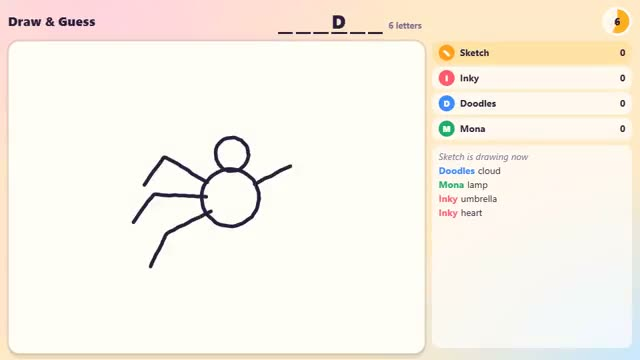

# Draw & Guess

One player draws. Everyone else guesses. A multiplayer starter game from [Multiplayer Agent](https://multiplayeragent.com): 2D, party, 3–10 players, with bots that fill empty seats.

## How it plays

Take turns drawing a secret word in 60 seconds. Everyone else types guesses, and faster right guesses score more. Letters show up as time runs out.

**Controls:** Mouse or finger to draw, type to guess.

## Make it yours in the Game Builder

Open the [Game Builder](https://multiplayeragent.com), choose **Start from a starter game** and pick Draw & Guess. It opens as version 1 in your studio, ready to play and publish. Then ask for changes, for example:

- Add a word pack about movies
- Add colors and an eraser
- Let players vote on the best drawing

## Run it yourself

1. Get a free publishable key (`pk_…`) at [multiplayeragent.com](https://multiplayeragent.com).
2. In `index.html`, put it in place of `pk_REPLACE_ME` in the `MP_CONNECT` block.
3. Open `index.html` in a browser. No build step and no server needed.

Without a key it still runs, offline against bots.

## How it is built

- One `index.html`. The comment at the top of the script maps the code and explains the multiplayer.
- **Hidden info:** The word is sealed so only the drawer can read it (the host picks it, so it can too).
- **Host-run rounds:** The host's browser picks the drawer and the word, checks guesses and keeps score; if it leaves, the next player takes over.
- **Bots:** Bots draw simple doodles and guess, sometimes right.
- **Leaderboard:** Each player's best game, in points.
- The words and the bots' doodles are in the `WORDS` section: a doodle is a few lines and circles in a 0–100 box.
- `?attract` runs it offline with bots only. The preview video is recorded from it.

## License

MIT.
